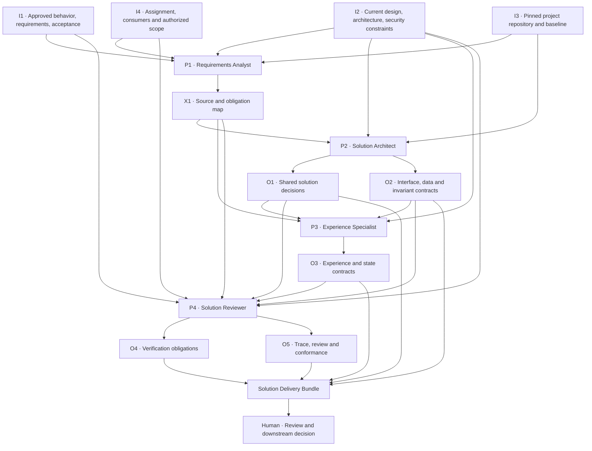

# S1 Input–Output Chain — Static Responsibility and Artifact Flow (Proposed)

> **Purpose:** The inspectable, harness-neutral **structural map** of which authoritative inputs support which Specialist responsibilities and versioned outputs. It preserves the path and traceability semantics of S1's structural producer–consumer relationships. It is **not** a required scheduling order, fixed subprocess topology, proof of configured Agents, or runtime evidence.
> **Companion:** [Interaction sequence](interaction-sequence.md) describes a possible bounded invocation's temporal flow, including Human gates, feedback and handoff.

## Artifact and producer–consumer graph

**Read an arrow as a required source/consumer dependency or evidence relation, not an immediate message, a mandatory sequential phase, or automatic acceptance.** The Human receives the deliverable from the Coordinator directly for review and downstream decisions; Balad is optional Human-only advisory, never an execution intermediary. X1's authority anchors and revision are carried into O5/the bundle.

## Path / edge contracts

| Source → process → artifact | Accountable producer | Consumer / check |
| --- | --- | --- |
| I1+I2+I3+I4 → P1 → X1 | Requirements Analyst | Architect + Experience + Reviewer: binding requirement/invariant IDs, original source revisions, design freedom versus Human-owned gaps |
| X1+I2+I3 → P2 → O1/O2 | Solution Architect | Experience + Reviewer + future implementation consumers: coherent shared decisions, interface/state/ownership/error and security obligations |
| X1+I2+O1/O2 → P3 → O3 | Experience Specialist | Reviewer + future frontend/backend consumers: truthful interaction and state behavior, supported by actual interface semantics |
| **Original** I1+I2+I4 and X1+O1+O2+O3 → P4 → O4/O5 | Solution Reviewer | Direct source fidelity and cross-contract review; required observable verification and findings, without changing producer artifacts |
| O1+O2+O3+O4+O5 → bundle assembly | [Space Coordinator Agent](../agents/space-coordinator/profile.md) | Human directly receives revision-pinned outputs, limitations, blockers and gate evidence for review; future compatibility requires evidence |

Reviewer findings are separate **control feedback**, described in [Interaction sequence](interaction-sequence.md): the owning producer revises the affected X1/O1/O2/O3 artifact, and the reviewer rechecks changed edges. Do **not** draw an unbounded feedback cycle in this static dependency DAG or let the reviewer silently rewrite producer-owned decisions.

## Generic invariant path test

For each applicable authoritative invariant, inspect a concrete trace:

`original I1 source anchor → X1 requirement/authority map → material O1/O2/O3 design anchor(s) → O4 future verification obligation(s) → O5 reviewer source check → consumer handoff`.

If a particular output category is not applicable, record a reasoned, inspectable non-applicability rather than invent content to fill the graph. Any missing **applicable** edge is a traceability/coverage gap, not a hidden PASS. A single invariant may require multiple interfaces or verification producers.

The reviewer receives original I1/I2 directly, not only producer summaries or X1. Agent-owned knowledge supplies technique but never replaces project authority. A downstream Go/NestJS/Next.js/etc. Space must be validated for both **generic I/O compatibility** and **project-bound current-output compatibility** when it actually exists; this diagram does not claim those edges are verified.

## Structural freedoms and constraints

The graph defines responsibilities and artifacts, not a fixed native Agent/session count or forced sequence. Human-direct Coordinator coordinates internal work in supervised-default or Human-explicit autonomous mode; [Human gates](human-approval-gates.md) apply in both modes. P2/P3 can coordinate/iterate on shared decisions, provided ownership and revisions remain clear. Reviewer independence and R1–R7 execution requirements remain in [execution requirements](execution-requirements.md) and require actual runtime evidence.

Stable artifact IDs I1–I4, X1, O1–O5 and their semantics come from [input](../contracts/input.md), [output](../contracts/output.md), [artifact envelope](../artifacts/format-and-traceability.md) and [responsibilities](responsibilities.md). This diagram is not a competing contract or implementation policy.
