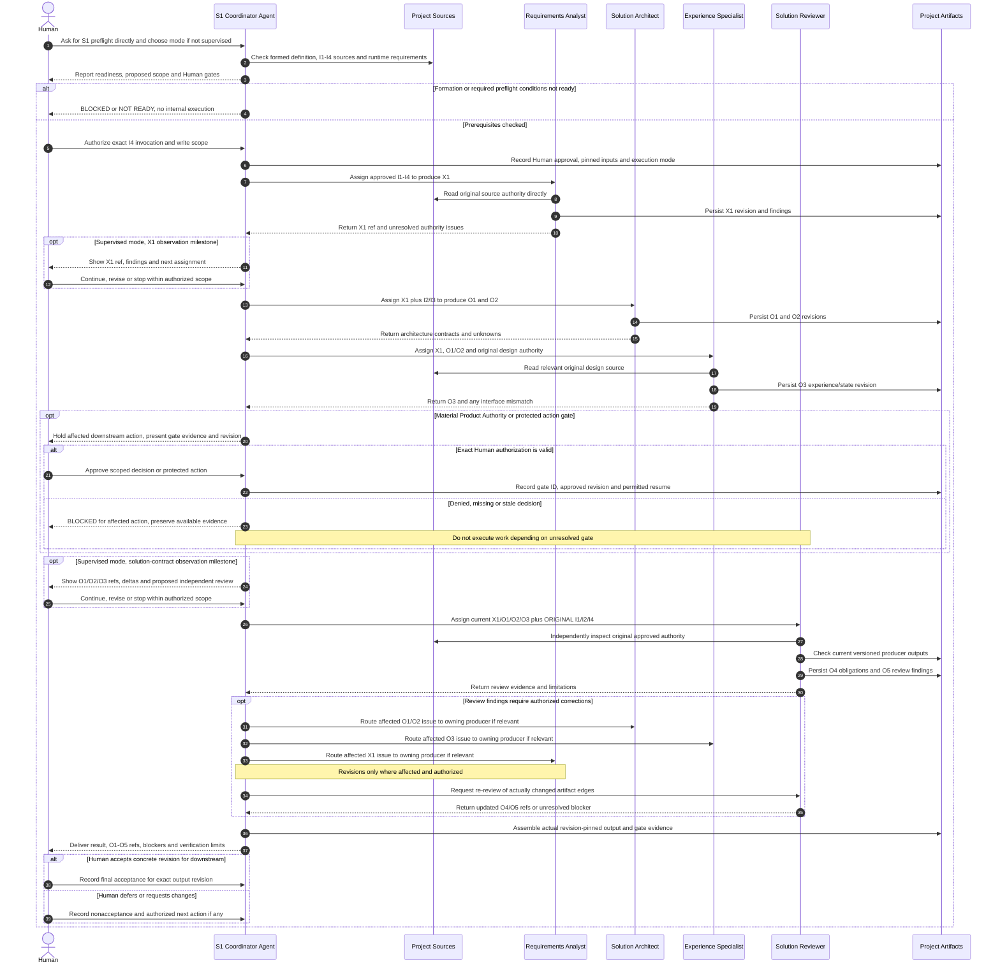

# S1 Interaction Sequence — Human-Direct Coordinator and Specialist Flow (Proposed)

> **Status:** Logical **harness-neutral** first-use interaction, not a native CLI configuration, executable workflow engine, or evidence of real dispatch.
> **External boundary:** **Human ↔ Space Coordinator Agent**. Balad may give the Human independent advice or review already-produced evidence on request, but has **no operational messages to the Coordinator**. Compare [input–output chain](input-output-chain.md) for static dependencies and [Human Approval Gates](human-approval-gates.md) for binding stop conditions.

## Execution and approval boundaries

## Interpretation

- **Formed Space + direct invocation first.** A file/profile does not instantiate an Agent. The Human initiates the Coordinator only after separate formation, actual runtime readiness and concrete scope authorization. Default mode is `supervised`. `autonomous` is valid only when explicitly selected by Human; the Coordinator cannot promote itself.
- **Supervision is not authorization.** In supervised mode, milestone `continue` steers ordinary work but **does not approve Product Authority, protected changes or final downstream acceptance**. The optional supervision pauses may be configured proportionately for the actual pilot.
- **Approval gates always apply.** In either mode, G1/G2 material decisions or protected actions pause the **affected dependent work** until exact Human authorization; other independent authorized work may continue. The diagram's following lines never override a BLOCKED gate.
- **No fixed Agent topology.** Runtime may use isolated subagents or explicit sessions after verification. These depicted messages express responsibility, not proof of native orchestration or automatic secure pause/resume. Reviewer must receive original authority independently and cannot revise producer output.
- **Real outputs and Human acceptance:** retain actual producer revisions, review findings, gate decisions and limitations. The final acceptance applies to an exact bundle revision; the Coordinator cannot self-approve. No Balad-to-Coordinator operational channel exists.
