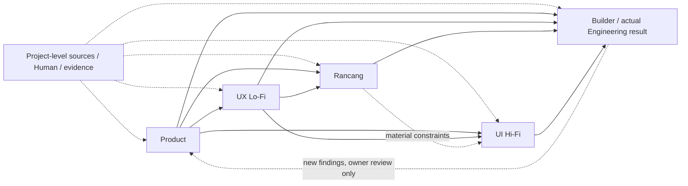

# Candidate Reference Model — Cross-Stage Information and Authority

> **Standing:** FORMALIZED RESEARCH REFERENCE FOR AUDIT — not a canonical Harscode lifecycle, not an operational policy, and not a formed Space. The underlying four Product/UX/Rancang/Hi-Fi working models were approved **for the experiment**; Engineering Builder remains a **working snapshot**. The 60-input source mapping is a candidate mapping, not verified project source availability.
> **Decision owner:** Anhar. **Formalization authorized:** 2026-11-04.
> **Reference source checkpoint:** `anhsbolic/harscode-workspace`, `refactor/harscode-foundation@96b479c1a4e1ead77bb1614ef49bf09aca435c0d`.
> **Write scope:** `research/cross-stage-mapping` only. No revision to source branch or operational branch.
> **Example:** Kencleng ORG-01 — one actor, Calon Pembentuk Organisasi; illustrative semantics, not target-project authority, runtime proof, or implementation authorization.

## Purpose and scope

Provide **one coherent audit reference** built from the [Product](product-definition.md), [UX Lo-Fi](ux-design-lofi.md), [Rancang](rancang-engineering-solution.md), [UI Hi-Fi](ui-design-hifi.md), [Engineering Builder](engineering-builder.md), and [five-stage input-source mappings](input-source-mapping.md). This file **indexes and interprets** those snapshots; it does not replace or independently re-approve them.

The candidate is a **semantic/authority/dependency model**, not a requirement for five successive Spaces, a document waterfall, a scheduler, or a universal workflow engine. A named concern is not necessarily one runtime Space or even one distinct file. A reusable Engineering Space may cover a bounded capability across concerns; a phase label does not grant production authority.

## Rules for evaluation

1. **Authority before origin:** Project-specific Product, UX/Design, security, Engineering, and approval decisions belong to their owning project artifacts at effective revisions. Harscode reusable guidance does not become project truth. An artifact's mere existence is not acceptance.
2. **Decision-specific sufficiency:** Inputs must carry enough information for the actual decision and its consequence. "Wajib" denotes the **information**, not one required upstream file or gate. Missing material information may block only affected edges; bounded exploration can use explicitly marked hypotheses.
3. **Many-to-many, non-linear provenance:** Inputs may come directly from multiple stage outputs, project-level current sources, Human decisions, and actual evidence. No mandatory phase completion or chain order is inferred.
4. **Distinct concern ownership:** Product owns meaningful actor outcomes, Domain Role meaning, consequential behavior and required domain information. UX Lo-Fi owns interaction flow, IA, webpage navigation/path decisions and behavior/state requirements. UI Hi-Fi owns final visual and interactive expression. Rancang owns technical architecture, interfaces, data, auth/security and verification design. Builder owns actual authorized implementation and evidence for its scoped result.
5. **Consumer-compatible standing:** Use original approved revisions, accepted scope, material unresolved decisions, and concrete consumer-fit checks. Reconciliation goes to the relevant owner; an Engineer/Design specialist cannot silently change another concern.
6. **Evidence claims are separate:** Working hypothesis, scoped Human approval, technical design, frontend/mock tests, integrated runtime verification, and delivered actor outcome are different claims.
7. **Preserve useful existing boundaries:** During audit, compare semantic coverage and consumer fit, not matching folder names, document counts, phase count, role titles, or visual appearance.

## Candidate concern model (logical outputs, not separate files)

| Concern | Inputs in working model | Logical outputs | Owns / does not own |
| --- | ---: | --- | --- |
| **Product — Product Definition** | 13 | (1) Product Intent & Value Definition; (2) Actor Definition & Goals; (3) Product User Journey; (4) Selected Product Outcome; (5) Product Contract; (6) Product Review & Approval Record | Owns Product value, Actor/Domain Role distinction, consequential Content & Information Requirements, invariants, success/acceptance and meaningful journey. Does **not** define UI screens, webpage routes, login timing or APIs. |
| **UX Design — Lo-Fi** | 11 | (1) Actor Scenario & UX Journey; (2) UX Flow Diagram; (3) Information Architecture; (4) Navigation Structure; (5) Webpage Map & Route Specification; (6) Lo-Fi Wireframes; (7) Interaction & UI State Requirements; (8) Lo-Fi Interactive Prototype; (9) UX Review & Decision Record | Owns interaction progression, structure and proposed/accepted webpage paths. Does **not** redefine Product meaning, backend API routes or technical enforcement. |
| **Rancang — Engineering Solution** | 13 | (1) Engineering Solution Blueprint; (2) Authentication & Authorization Design; (3) API Contract; (4) Data Model & Database Design; (5) State & Error Handling Design; (6) Security Design; (7) Technical Verification Specification; (8) Engineering Solution Handoff | Owns feasible technical mechanism and consumer contracts, not Product Domain Role meaning or independent UX webpage path authority. Hi-Fi is **not a default input**; material Design constraints arrive as consumable requirements. |
| **UI Design — Hi-Fi** | 13 | (1) Hi-Fi Screen Designs; (2) Interactive Prototype; (3) Responsive Designs; (4) UI Interaction States; (5) UI Components & Styles; (6) Reusable UI Component Library if justified; (7) Final UI Copywriting; (8) Final Visual Assets; (9) Design Review & Acceptance Record | Owns visual/content/interaction expression in scope. Requires explicit Lo-Fi **Webpage Map & Route Specification** as Design contract. Does not silently redesign navigation or Product policy. |
| **Engineering — Builder** | 10 | (1) Functional Web UI; (2) Working Backend API; (3) Operational Database Structure; (4) Integrated Application; (5) Test & Verification Results | Illustrative **end-to-end actor outcome**, not a claim that one current Space must implement frontend, backend and DB. Must preserve source revision, scoped acceptance and unresolved decisions. This stage is still only a working snapshot. |

**Total:** 60 candidate input items, each with one or more candidate sources in [input-source-mapping.md](input-source-mapping.md). For exact item names, optionality, process activities and individual outcomes, **the linked owning model prevails**. This document intentionally does not duplicate all 60 links or their six Mermaid diagrams.

## Cross-stage consumption model

Solid arrows represent typical **information consumption**, dotted arrows conditional/feedback sources. Arrows are **not invocation permissions, file dependencies, sequential mandatory work, or automatic mutation rights**.

### Focused provenance examples

- Product acceptance criteria → UX decisions, Rancang technical verification specification, and Builder verification. This is shared consumption, not shared authority to rewrite Product decisions.
- Lo-Fi UX Flow, Interaction/UI States and Webpage Map → Rancang, Hi-Fi and Builder where applicable. Lo-Fi webpage paths are distinct from Rancang-owned backend API endpoints.
- Rancang architecture, authorization, API, schema, state/errors and security → engineering implementation; technical constraints may be reported to Design for reconciliation.
- Project codebase, standards, Design System, asset library, usability findings and Human decisions → relevant consumers directly; no preceding phase is required to manufacture copies.

## ORG-01 end-to-end reference test

**Example required Product meaning:** the new organization context and valid attributable first internal `Owner` relationship must be one truthful, durable success. A response-lost/unknown result is not automatically success or failure.

- **Product:** meaning of Owner, attributable combined success, truthful failure/unknown, acceptance criteria.
- **UX Lo-Fi:** pre-effect comprehension, review/submit interaction, navigation and truthful success/failure/uncertain action paths.
- **Rancang:** technical attribution, atomicity, data/integrity, authorization, idempotency/recovery, technically checkable test obligations.
- **UI Hi-Fi:** coherent screens/copy/responsive states that preserve the agreed UX and Product truth.
- **Builder:** authorized actual implementation plus tests and **separate integrated runtime evidence**; frontend mock tests alone cannot prove database atomicity.

This is an **illustrative model test**, not a new Kencleng Product Contract or claim of runtime execution. A conceptual chain can be coherent while its actual project artifacts remain absent or incomplete.

## Explicitly unresolved matters

- This candidate's five concern headings are **not** a mandated decomposition of current Harscode's six Product guidance phases or its formed Engineering Spaces. Compare actual semantics, not 5-vs-6 labels.
- Source categories in mapping have **not** been authenticated as real project-level artifacts; provenance edges are not verified artifact-to-artifact trace links.
- Distinguishing generic feature-wide Builder outcome from an individual frontend-only Space's authorized output is essential. A narrower Space may be perfectly valid without satisfying the overall integrated actor outcome.
- No independent user testing, full repository compatibility proof, runtime correctness, Product/Design authority amendment, Engineering formation amendment, or operational promotion is claimed.
- This audit reference is intentionally **revisable** if repository evidence shows a flaw in the candidate model. Evidence can justify *rejecting* a candidate rule rather than altering existing implementation.

## Related audit

[Foundation gap assessment](foundation-gap-assessment.md) evaluates the existing refactor research branch against this candidate. Its findings remain evidence-backed **audit hypotheses and observations**, not automatic instructions to rewrite authoritative project sources.
