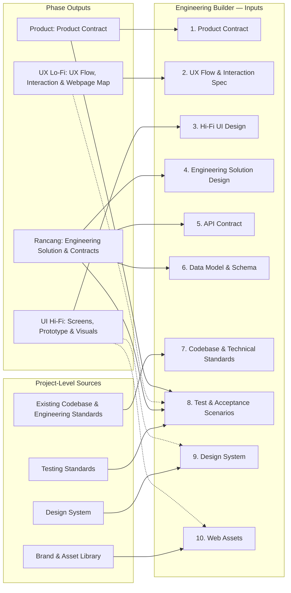
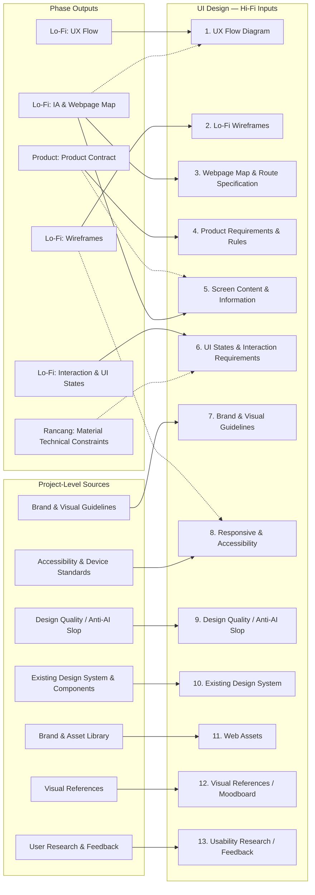
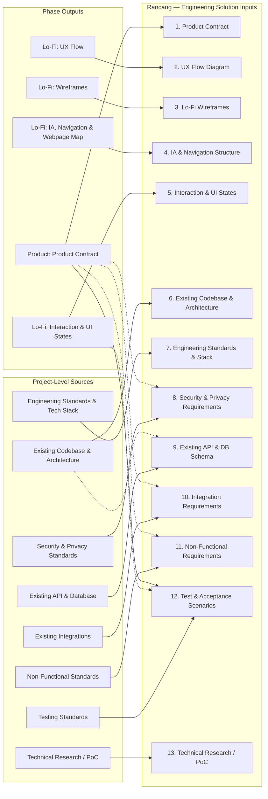
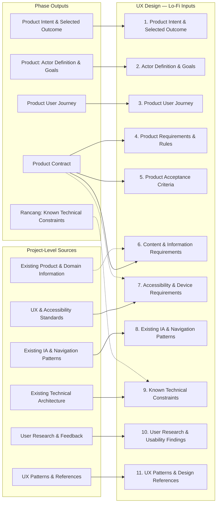
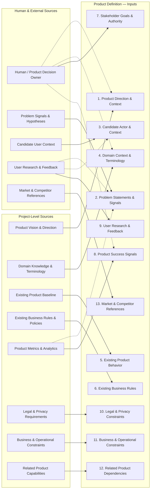
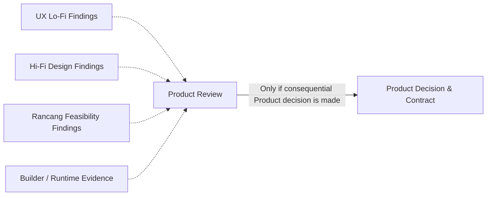

# ORG-01 — Reverse Input–Source Mapping (Five Stages)

> **Status:** CANDIDATE CROSS-STAGE MAPPING / WORKING EXPERIMENT — NOT VERIFIED, NOT CANONICAL.
> **Owner of experiment decisions:** Anhar. **Persist authorized:** 2026-11-04.
> **Repository scope:** Harscode-Workspace `refactor/harscode-foundation` (research only; operational `main` remains unchanged).
> **Basis:** [Engineering — Builder](engineering-builder.md), [UI Design — Hi-Fi](ui-design-hifi.md), [Rancang](rancang-engineering-solution.md), [UX Design — Lo-Fi](ux-design-lofi.md), and [Product](product-definition.md) working models.
> **Scenario:** Calon Pembentuk Organisasi (illustrative ORG-01); no audit or comparison to existing Kencleng ORG-01 implementation or artifacts.

## Purpose and reading guide

Map each stage's **inputs** back to likely **outputs of one or several other stages**, **project-level sources**, or **Human / external evidence**. A stage does **not** necessarily wait for the preceding stage or an entire producing stage to finish. **Wajib / conditional / nice-to-have** statuses remain defined in the linked stage models; diagram edges are information provenance candidates, not new requirements or a state-machine/execution workflow.

- Solid arrow `-->`: **candidate primary/direct information source**.
- Dotted arrow `-.->`: **candidate additional or conditional source**.
- Source category labels (e.g. "Project Design System") **do not assert an actual artifact exists**. No specific source path, current revision, ownership, or suitability has been verified.
- A single Builder/Rancang/Design input may be **multi-source**. That does not grant a non-owner authority to change a Product, UX, or Engineering decision.
- This document records the mappings discussed, **not** a complete cross-stage coherence audit. Any gap is noted without silently rewriting an already accepted stage working model.

## 1. Engineering — Builder (10 inputs)

**Key composite input:** `Test & Acceptance Scenarios` receives Product acceptance criteria, Rancang technical verification, project testing conventions and potentially UX interaction cases. `Design System` and `Web Assets` may come directly from project-level sources and/or final Design outputs; in the Builder model they are conditionally required if the accepted design/project requires them.

## 2. UI Design — Hi-Fi (13 inputs after approved clarification)

**Reconciled cross-stage mapping (2026-11-04, approved by Anhar):** Lo-Fi's **Webpage Map & Route Specification** is now explicitly listed as required Hi-Fi input; accepted webpage paths, page purpose, navigation, and page-vs-state choices remain Design-owned. Rancang may provide material technical constraints for reconciliation without becoming a mandatory predecessor. Brand Guidelines require explicit visual-direction permission if absent.

## 3. Rancang — Engineering Solution (13 inputs)

**Boundary:** Rancang directly consumes Product meaning, Lo-Fi UX, and project engineering reality. It owns API design and technical enforcement, **not** webpage navigation authority. **Hi-Fi is intentionally not a default Rancang input** and no special visual-format interpretation capability is required. A PoC need not pre-exist; Rancang may generate bounded research/evidence if a material unknown warrants it.

## 4. UX Design — Lo-Fi (11 inputs)

**Reconciled cross-stage mapping (2026-11-04, approved by Anhar):** Product Contract explicitly includes **consequential Content & Information Requirements** and supplies Lo-Fi input #6. Existing project-level domain information may provide context; Product owns mandatory domain information, while UX owns presentation and interaction. Actual coverage/sufficiency of a concrete project Product Contract still requires future verification. Rancang constraints remain optional/conditional: UX exploration does not need to wait for Rancang to finish.

## 5. Product — Product Definition (13 inputs)

Product's earliest inputs often arise from project-level authority, stakeholders, domain knowledge, and external evidence, **not** from a mandatory prior lifecycle stage. Existing observed behavior is evidence of the system's condition, but does not automatically establish the correct Product policy.

### Optional feedback to Product (not a mandatory prerequisite)

A phase finding is **not automatically** a Product Contract change. Reconciliation and relevant Human/Product authority are required for consequential changes.

## Lightweight coherence review (2026-11-04)

Review of the five experiment working models and candidate mapping yielded three small corrections, **approved by Anhar and reflected in their owning models**:

1. **Lo-Fi → Hi-Fi:** add explicit **Webpage Map & Route Specification** as Hi-Fi input (13 Hi-Fi inputs after change). No new artifact or transfer of webpage-path authority.
2. **Product → Lo-Fi:** clarify **Content & Information Requirements** within Product Contract for consequential information (not a new output/document); UX owns the grouping and presentation.
3. **Consumed artifact standing → Builder:** preserve **relevant source revisions, scoped acceptance standing, and material unresolved decisions** with the artifacts used for implementation. No additional approval mechanism.

Other observations:

- **Non-linear and multi-source:** direct Product → Builder, Lo-Fi → Rancang and Hi-Fi, project standards → multiple consumers, and Product + Rancang + project testing standards → Builder acceptance/testing inputs.
- **Project-level sources are first-class:** codebase, current standards, design systems, evidence and constraints should not be recreated by arbitrary preceding stages. Their actual authority and revisions have not yet been checked.
- **Shared consumption is not duplicate ownership:** multiple phases may read the same Product Contract, UX Flow or Design System; changes to owner-controlled semantics still require reconciliation.
- **Feedback is not auto-approval:** feasibility, user feedback and implementation evidence may trigger owner review, not silently supersede existing decisions.

**Coverage count:** 60 mapped candidate inputs across 5 stages (10 Builder + 13 Hi-Fi + 13 Rancang + 11 Lo-Fi + 13 Product). Every input has a candidate source; this does **not** prove those sources exist or are sufficient.
## Standing / next review boundary

**Completed:** candidate reverse mapping for all five phases with Mermaid and a lightweight coherence review, including the three Anhar-approved internal contract clarifications. **Not completed:** verified artifact-to-input traceability, deep cross-stage audit, source existence/version/authority verification, project-specific feasibility, or runtime validation.

Only the approved clarifications were applied to existing experiment models (Product, Lo-Fi, Hi-Fi, Builder) and this candidate mapping; Rancang model is unchanged. Harscode operational `main`, existing Rancang/Product/Design authority, and Kencleng ORG-01 artifacts remain unchanged. Further changes to stage models, project-specific verification, or operational promotion require separate scoped decisions.
