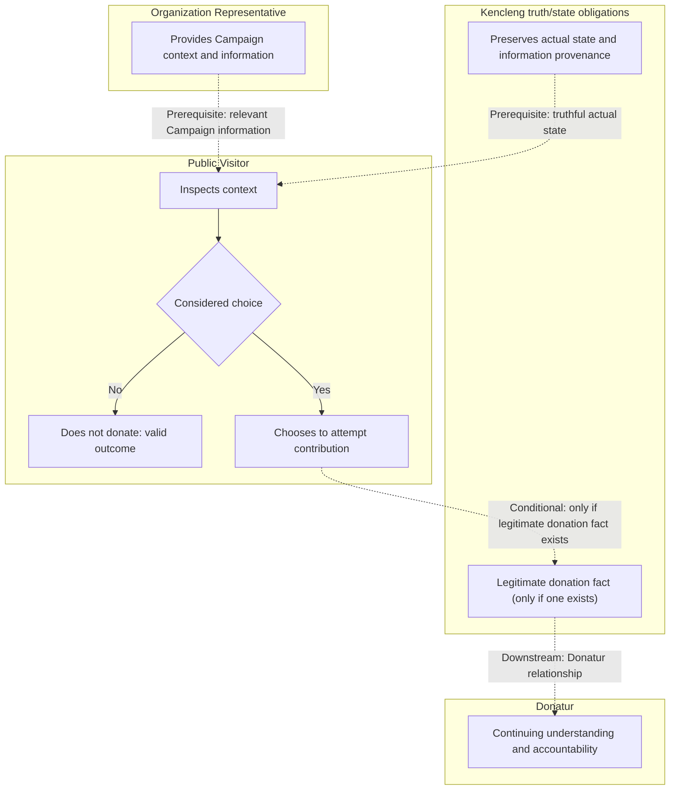

# Interconnected Journey Blueprint — Experimental Research v0

> **Status:** EXPERIMENTAL / RESEARCH-ONLY — **not canonical or operational Harscode policy**.
> **Date:** 2026-10-21
> **Owner:** Harscode Product-method research on `refactor/harscode-foundation`.
> **Test context:** Kencleng `pilot/station5-c1-space-only`, *not* Kencleng operational `main`.
> **Standing:** Human-approved **permission to experiment and preserve this draft format**, not approval that the method works or must be adopted.
> **Upstream authority:** The target project's current approved Product Authority determines product truth. Harscode [Product Foundation](foundation.md), [Experiences and Commitments](experiences-and-commitments.md), and [Product Handoff](handoff.md) remain the current reusable **research guidance**. This file cannot amend them by implication.

## Research problem and hypothesis

**Problem:** A Product discussion can describe end-to-end business/domain state changes yet lose the human value narrative, actor-specific starting conditions and cross-actor dependencies on the way to selecting a product commitment. A plausible commitment might therefore be selected before its real prerequisites and downstream meaning have been challenged.

**Hypothesis to test:** A progressively elaborated **Interconnected Journey Blueprint** that connects business value, actor `From → To` journeys, meaningful business consequences and typed cross-actor dependencies will help discover appropriately bounded product capabilities/commitments without making Design or Engineering invent missing Product Truth.

This is **not yet demonstrated** by the accepted Stage 1 result; Stage 2–3 and eventual consumer use remain untested.

**Scope of this experiment:** Use a connected value story to explore actor experiences and dependencies *before* commitment selection. Preserve proven project-specific commitments and approvals separately. Avoid turning this exercise into a mandatory stage model, generalized process engine or universal deliverable.

## Evidence and starting point

- **Accepted Stage 1 working pilot reconstruction:** [Kencleng Business / Value Loop checkpoint v0.2](https://github.com/anhsbolic/kencleng/blob/7b8b344e2013f5c5389d84d620b70948a3ebfd1f/docs/product/pilot-3-business-value-loop.md), accepted by Anhar on 2026-10-21. It contains the human/business `From → To` story, Organization/Campaign, Person and Trust/Evidence threads, main responsibility handoffs, truth boundaries and open questions.
- **Product authority:** The pilot's `docs/product/product-intent.md`; approved Product Design sources inform experience quality **within their own ownership**. Do not transplant their visual patterns into new business rules.
- **Comparison evidence:** Historical pilot Stage 2–3B and commitment-specific C1 decisions are prior work, *not* the result of this new experiment. Do not treat the Stage 1 reconstruction as automatically superseding approved C1-specific behavior.
- **Current observation:** The existing Harscode Product Foundation was sufficient to reconstruct Stage 1 without changing reusable guidance. That does **not** prove the proposed Blueprint or downstream Rancang handoff.

## Experimental format v0 — one story, progressively elaborated

The Blueprint is a **logical view**, not a mandatory file type, stage count, diagramming tool, schema or complete all-journeys map. An overview with linked, bounded details is preferred over an unreadable single diagram.

| View element | Minimum semantic question | Timing/depth |
| --- | --- | --- |
| **Value anchor** | Which approved human/business value and initial unmet condition make the journey worth exploring? | Start from project-owned Stage 1 value story; preserve source revision |
| **Actor / responsibility lane** | Who initiates, decides, supplies information, is affected, or exercises bounded authority? Is this a person/role, domain entity, or system obligation? | Initially representative actors; expand only when material |
| **Initial situation (FROM)** | In what situation does the actor begin? What do they know, need or seek? Separate trigger/motivation from current state. | Actor outcome discovery |
| **Meaningful progression** | What actions, business process handoffs, decision points and truthful state consequences connect FROM to TO? | Semantic events, **not** screens/API requests |
| **Resulting outcome (TO)** | What can the actor legitimately conclude, do or inspect afterward? Include valid non-participation/failed/unknown outcomes when material. | Actor journey and scenario discovery |
| **Interconnections** | Which *specific state or outcome* of another journey is required, conditionally relevant, or downstream? | Explore and challenge in Stage 2–3 |
| **Truth, authority and evidence** | What is fact, assertion, bounded judgment, reported, pending, hypothesis, approved or unknown? Who owns a material decision? | Across every relevant connection |
| **Commitment frontier** | What coherent, meaningful, dependency-closed-enough product outcome is a **candidate** for Human selection? | Only after sufficient journey/dependency exploration |

**Continuity invariant:** Every materially selected capability should have a defensible trace `product value ↔ actor outcome ↔ interconnected experience / dependency ↔ candidate commitment`. This need not become a rigid traceability table or a separate user story per technical subtask.

**Initial situation is not merely motivation.** Example: “wants to donate” is one possible trigger; “has not yet understood a specific Campaign and does not yet have its donation relationship” is closer to a situation. A visitor may also be seeking information without donation intent. Do not claim these motivations were user-research validated.

**Actor change:** One person may become a Donatur after a *legitimate donation fact* without needing a different demographic persona. Keep business role, account state and person identity conceptually distinct.

**System lane:** Kencleng/System is an obligation layer, not a human actor or implied omniscient authority; Organization and Campaign are domain contexts, not human personas.

## Interconnection rules to test

Edges should connect **why one journey/state matters to another**, not merely show that two actors exist.

| Edge meaning | Test | Effect |
| --- | --- | --- |
| **Prerequisite** | Without this real product behavior/outcome, can the claimed target outcome truthfully exist? | A genuine dependency that may require inclusion, prior delivery or an explicit blocker |
| **Conditional** | Only when an identifiable condition applies does the other judgment/action/state matter? | Preserve condition; do not silently universalize |
| **Downstream** | Does the first outcome create a new need, responsibility or journey later? | Preserve continuity, **not automatic prior implementation order** |
| **Feedback / re-entry** (optional) | Does new evidence or a returned judgment cause a prior actor to revisit work? | Show when materially clarifying, not as a mandatory lifecycle machine |

A dependency can have unknown standing pending verification; don't turn a candidate edge into a fact without a source or authorized decision. Distinguish **semantic prerequisites** from convenient implementation dependencies, seeded fixtures, or merely adjacent business processes. No total linear roadmap follows automatically from the graph.

## Suggested visual notation v0 (replaceable)

**Default experiment:** Mermaid flowchart with actor/responsibility subgraphs for a *readable overview*, optionally supported by a compact text/table legend. This is a documentation convenience, not a semantic requirement. Excalidraw, FigJam, or another medium may replace it based on observed readability.

- **Solid arrows:** meaningful progression and business consequences *within* a bounded journey; not a universal execution order.
- **Dashed, explicitly labeled arrows:** typed interconnections **(prerequisite / conditional / downstream / feedback)**. Label the required state/outcome and condition, not just an actor name.
- **Decision nodes:** meaningful alternatives (e.g., no donation is valid), not implementation/UI navigation.
- **Nodes:** use plain labels naming actor situation, consequential action, bounded judgment or resulting state. Distinguish them in text when shapes alone are ambiguous.
- **Standing:** important assumptions and unresolved decisions must be referenced or labeled as such; diagram style must not upgrade their evidentiary status.
- **Complexity cap:** if the overview becomes a hairball, retain a small whole-product map with references to scoped journey fragments. No mandate to map every exception before choosing any commitment.

### Small *illustrative* Kencleng fragment

This demonstrates the notation only; it is **not** a newly approved Kencleng Product rule or a diagram of a mandatory donation flow.

**Illustration limitations:** Organization review, Campaign curation, publication and donation eligibility have distinct meanings; this fragment asserts no automatic gate among them. Choosing/attempting donation is not a donation fact, and a donation fact is not automatically a funding consequence.

## Research execution and checkpoints (not mandatory Harscode phases)

1. **Stage 1 — already accepted for this pilot:** Human/business value story, intersecting value threads, truthful boundaries and responsibility handoffs. Stage 1 need not detail all actor journeys.
2. **Stage 2 — next experiment:** Derive actor-specific `initial situation → meaningful outcome` and responsibilities from the same value anchor. Check that the story remains continuous across affected actors, including non-participation and distinct business roles.
3. **Stage 3 — subsequent experiment:** Explore representative interconnected journeys; challenge prerequisite vs conditional vs downstream edges, absent real capabilities, conflicting authority, negative paths and candidate commitments. Do not presume the old Stage 3B choice is correct *or* incorrect.
4. **Product → Rancang later:** Test whether selected commitment behavior, acceptance and dependency standing can be consumed without inventing Product Truth. **Detailed interaction/sequence diagrams (Layer 2) are not a required Product deliverable**; Rancang may determine whether they add value, within its authorized scope.
5. **Per-stage checkpoint:** Compare current Harscode research guidance to the observed problem. Record a specific demonstrated gap and owner before any proposed reusable-guidance revision. No automatic method promotion.

### Evaluation prompts

- Can a fresh reader reconstruct the relevant value story and each journey's FROM and TO using durable sources, without remembered chat?
- Can they explain *which outcome/state* each cross-actor link depends upon, its type and evidence standing, rather than treating all edges as release gates?
- Does a proposed commitment remain meaningful, truthful, bounded and dependency-closed enough, with material Human-owned decisions explicit?
- Did the Blueprint reveal a dependency/authority blind spot that historical Stage 1–3B work missed? Or merely redraw known knowledge?
- Does it increase convergence and usability, or create unreadable diagrams, rework, duplicate state, false sequencing and excessive ceremony?
- Can Design/Rancang consume the selected semantics while retaining solution freedom, **without the Product phase producing mandatory Layer 2**?

### Evidence classifications / possible outcomes

- **Observed Stage 1:** Business value narrative reconstructed and accepted, documented at a pinned Kencleng revision; not a user research finding.
- **Current unknown:** Stage 2–3 detection quality, reusable value beyond this pilot, independent consumer comprehension and Rancang execution.
- **Positive:** Record actual improvement with examples and provenance; propose the *smallest* guidance adjustment at the owning boundary and request Human approval.
- **Neutral:** Existing guidance is already sufficient; keep Blueprint as optional local technique, without adding a standard.
- **Negative:** Simplify, replace, or abandon the format when overhead, confusion or false dependencies outweigh learning/quality.

## Authority and persistence rules

- This file preserves a **research method under test**, not Kencleng Product Truth and not an operational Harscode instruction.
- Any accepted *Kencleng-specific* journey, business behavior or commitment belongs in the appropriate **Kencleng** artifact and exact revision, under the scope of its approval. Harscode may link to research evidence but should not duplicate authoritative product semantics.
- Keep branch context explicit: Harscode `refactor/harscode-foundation` is research; Harscode `main` is operational; Kencleng pilot is not Kencleng `main`. No repository authority or runtime activation changes through this file.
- Follow [Product Handoff](handoff.md) for consumer-readiness; no one-to-one mapping between commitment and Engineering Space is implied.
- Human approval is required for material changes to Product Authority or promotion of this experimental format into reusable Harscode policy.

## 2026-10-21 — Approved Level 2 Kencleng checkpoint and research reframe

> **Standing:** HUMAN-APPROVED **RESEARCH CHECKPOINT** in Kencleng; Harscode records evidence/reframed hypothesis **only**. This section updates the **current experiment position**, not Harscode operational `main` or the reusable guidance in [experiences-and-commitments.md](experiences-and-commitments.md) and [handoff.md](handoff.md).
> **Project-owned source:** [Kencleng Interconnected Journeys checkpoint](https://github.com/anhsbolic/kencleng/blob/00ccf35d4f2cbec29721a6390a29804e50675760/docs/product/interconnected-journeys/README.md) and [Level 2 network v0.2](https://github.com/anhsbolic/kencleng/blob/00ccf35d4f2cbec29721a6390a29804e50675760/docs/product/interconnected-journeys/level-2-network.md), on **pilot/station5-c1-space-only**. The `00ccf35d4f2cbec29721a6390a29804e50675760` revision is a durable Kencleng pilot research checkpoint, **not** Kencleng operational `main`.

### What changed in the research question

The original format emphasized deriving/selecting a bounded **Commitment** after representative scenarios. Anhar challenged whether that abstraction is necessary. **For this ongoing experiment**, Commitment-based Stage 3B is **paused**; earlier C1 approval/history is **not** revoked. The test is now whether a sufficiently detailed interconnected experience/state network can support responsible **starting-point and dependency sequencing reasoning** and ultimately a bounded, Human-approved input to Rancang, **without a mandatory Commitment artifact or registry**. Whether any extra mediation function is needed remains to be learned.

Anhar accepted **two representational resolutions**, not mandatory delivery phases:

1. **Journey Landscape / helicopter view:** R1 Organization, R2 Campaign, R3 Visitor/Donation, R4 Accountability, plus X1 privileged exception. The previously accepted Stage 3A was adequate at this representative level.
2. **Interconnected Meaningful Transitions / road-network view:** 26 working nodes (R1 five, R2 eight, R3 seven, R4 six), including local transitions, typed cross-actor dependencies, feedback/re-entry, non-donation, uncertain and failure states, actual Campaign public/eligibility distinction, money-state distinctions, and accountability even with zero Donatur.

Resolution is chosen by **meaningful product consequence**, not domain, screen, CRUD operation or database event. The map should be whole enough to reveal candidate starting paths but not falsely spec the entire product at uniform depth.

### Observations and cautions

- **Observed in the same-session analytical reconstruction:** Initial 19-node decomposition hid material branches and misleading direct links. The reviewed 26-node revision made explicit Organization review/reconsideration, Campaign curation revision loops, publication versus eligibility, changes affecting in-flight contribution, donation fact versus funding/settlement, and accountability beginning before closure and existing without donors. These boundaries were tested against existing accepted Kencleng source semantics; **many were already known in historical Stage 3A/C1**, so this does not prove new domain discovery.
- **Human decision:** Anhar approved the corrected Level 2 completeness/connection audit as a **Kencleng-specific Product research checkpoint** and authorized durable recording both in Kencleng and Harscode research repositories. The Kencleng directory is intentionally named `docs/product/interconnected-journeys/`, not another `pilot-*` file, but **branch/scope and project authority precedence remain unchanged**.
- **Not established:** Empirically better sequencing choice, the correct first work item, independent fresh-reader usability, design/engineering consumer fit, actual code/runtime prerequisites, horizontal capabilities/environment readiness, Rancang runtime readiness, or a more efficient generalized Harscode method. Previous graph connectivity counts are not causal or execution evidence.
- **Preserved boundaries:** Product-led semantic sequencing is not a total roadmap; conditional review is not universal; partial/seeded states do not prove actual delivery. Rancang Engineering technical authority and Human-direct invocation/approval remain separate.

### Explicit pause and next experiment

**Stop after the approved Level 2 checkpoint.** Next, **discuss how to select the first healthy starting point** and the appropriate depth/authority threshold, using the current mapped journeys. Do not automatically name O1, P1, or V1 as first work. **Engineering Readiness & Dependency Reconciliation remains on hold by Anhar's direction.** No Engineering invocation, product roadmap, implementation, Harscode reusable-guidance amendment, or `main` promotion is authorized.

This section supersedes **time-relative next-step expectations** in earlier research notes (e.g., “Stage 2 is next,” “proceed to Commitment-based Stage 3B”) for the **current experiment only**. Historical document content, approvals and source lineages remain available as recorded evidence.
