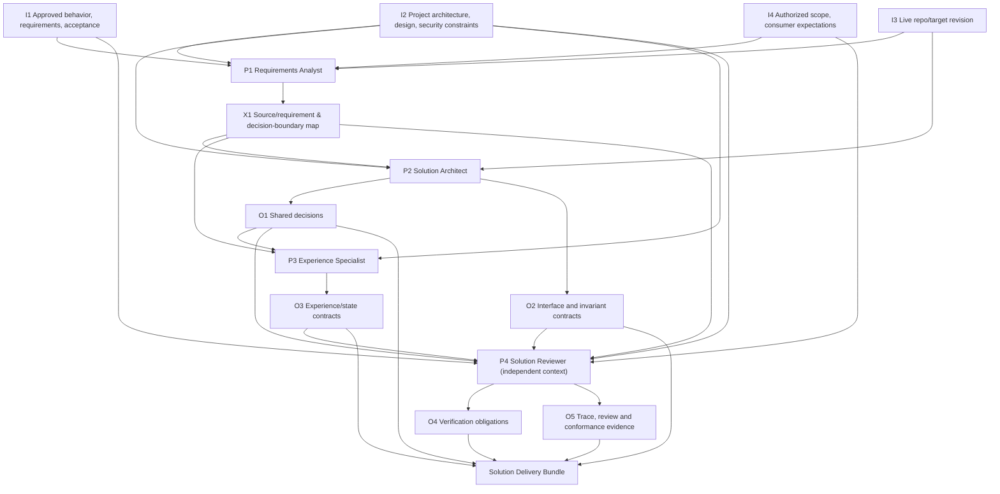

# S1 Input → Specialist → Output Path Relations — Proposed

This is an **inspectable responsibility and evidence DAG**, not a mandatory sequential engine. Node/edge labels are semantic contracts, not assumed files, job IDs or native Agent objects in any particular harness.

## Internal production paths

## Edge contract / accountable responsibility

| Producer input → process → output | Accountable Specialist | Consumer and acceptance |
| --- | --- | --- |
| I1+I2+I3+I4 → P1 → X1 | Requirements Analyst | Architect and Experience Specialist: cited scope, binding invariants, open decisions, authorization/tech constraints; source classification correct |
| X1+I2+I3 → P2 → O1/O2 | Solution Architect | Experience Specialist + Reviewer + backend/frontend consumers: architecture, ownership, explicit interaction/transport/data semantics and errors, without inventing authority |
| X1+I2+O1/O2 → P3 → O3 | Experience Specialist | Reviewer + future frontend/backend consumers: experience states, form/action conditions and consequence/persistence meaning, consistent with interfaces |
| Original I1+I2+I4 and X1+O1+O2+O3 → P4 → O4/O5 | Solution Reviewer | Space outcome: independent source fidelity, coverage and cross-contract findings; no edits to producer artifacts |
| O1+O2+O3+O4+O5 → bundle assembly | Space coordinator responsibility | Human/Balad for scoped decision and handoff; future consumers only after accepted, compatible real output |

Reviewer findings affecting X1/O1/O2/O3 go **back to the responsible producer** for scoped revision, then affected review re-runs. The coordinator records version compatibility and whether follow-up is required. The reviewer may author findings/verification obligations but not quietly “fix” producer material.

## Invariant propagation test (generic)

For a material project invariant: locate original source anchor → X1 requirement/authority map → O1/O2/O3 design commitment(s) → O4 test obligation(s) → O5 reviewer source check → future consumer. Missing any applicable link is a traceability/coverage failure. A test obligation may have more than one evidence producer.

The reviewer must receive *original I1/I2*, not only X1 or producer descriptions. Agent-owned knowledge can inform techniques but never establishes authoritative project behavior. The diagram does not claim consumed inter-Space links: future Go/NestJS/Next.js contracts must be checked when they exist.

## Scheduling and independence

P2 and P3 may collaborate/iterate on shared decisions, but they cannot produce contradictory accepted contracts. P4 must be sufficiently isolated from production reasoning to credibly check against originals; prefer a fresh context when supported. If the selected runtime cannot provide demonstrable independence, report the limitation, do not fabricate it. No hard-coded four-session requirement or parallelism.
